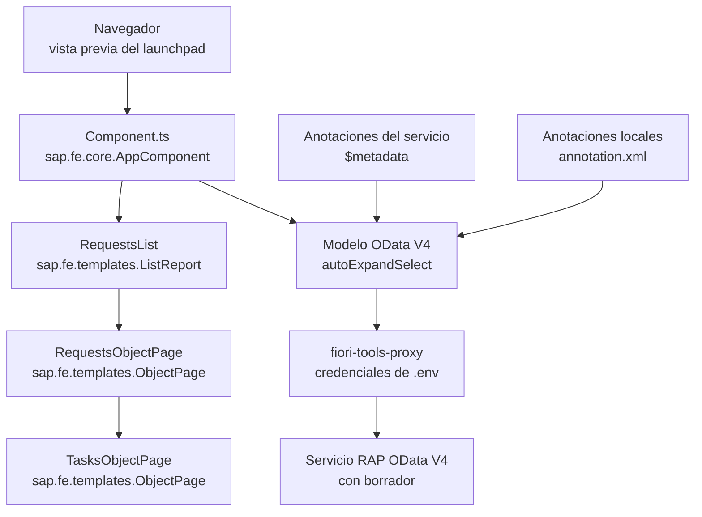

# Arquitectura de la aplicación "Planificación de avisos"

## 1. Datos generales

| Dato | Valor |
|---|---|
| Id | `sapui5.maintenanceplanner` |
| Plantilla | List Report Page de SAP Fiori elements para OData V4 |
| Componente | `webapp/Component.ts`, que extiende `sap/fe/core/AppComponent` |
| UI5 | 1.148 (`minUI5Version` 1.148.0) |
| Lenguaje | TypeScript |
| Servicio | `/sap/opu/odata4/sap/zui_mnt_request_o4/srvd/sap/zui_mnt_request/0001/` (`docs/servicio.md`) |
| Anotaciones locales | `webapp/annotations/annotation.xml` |
| Textos | `webapp/i18n/i18n.properties` (inglés) e `i18n_es.properties` (español), modelo `@i18n` |

## 2. Diagrama de componentes

## 3. Páginas y rutas

Las páginas y las rutas no se programan: están en `sap.ui5.routing` del `manifest.json`.

| Ruta | Patrón | Página | `contextPath` |
|---|---|---|---|
| `RequestsList` | `:?query:` | `sap.fe.templates.ListReport` | `/Requests` |
| `RequestsObjectPage` | `Requests({key}):?query:` | `sap.fe.templates.ObjectPage` | `/Requests` |
| `TasksObjectPage` | `Requests({key})/_Task({key2}):?query:` | `sap.fe.templates.ObjectPage` | `/Requests/_Task` |

La configuración de cada página va en `targets.<página>.options.settings`: carga inicial, tipo de tabla, navegación, secciones y acciones propias.

## 4. Capas de anotaciones

Fiori elements construye la interfaz a partir de dos fuentes de anotaciones, en este orden:

1. Las del servicio, que llegan en `$metadata`.
2. Las locales de `annotation.xml`, declaradas en `sap.app.dataSources.mainService.settings.annotations`.

Si las dos anotan el mismo destino con el mismo término y el mismo calificador, prevalece la local, y la sustituye entera: no se combinan. Por ejemplo, un `UI.LineItem` local sustituye por completo a uno del servicio.

## 5. Lo que ya aporta el servicio

| Anotación del servicio | Efecto en Fiori elements |
|---|---|
| `Common.DraftRoot` y `Common.DraftNode` | Crear, Editar, Guardar y Descartar con borrador, sin código |
| `Core.OperationAvailable` (`__OperationControl`) | Habilitación de `assign`, `startWork`, `complete`, `reject` y `Edit` según el estado |
| `Capabilities.DeleteRestrictions` y `UpdateRestrictions` (`__EntityControl`) | Habilitación de Borrar y de la edición |
| `Common.ValueListReferences` | Ayudas de búsqueda de planta, equipo y material |
| `Common.ValueListWithFixedValues` | Tipo y prioridad como listas desplegables |
| `Common.Text` | Textos de tipo, prioridad, planta y equipo junto al código |
| `Common.FieldControl` (obligatorio) | Campos obligatorios marcados en edición |
| `Common.SideEffects` | Relectura de los datos afectados tras un cambio o una acción |
| `Common.Label` | Etiquetas de campos, columnas y parámetros de acción |
| `Core.MediaType` y `Core.ContentDisposition` | Descarga del adjunto con su nombre de fichero |

Las propiedades `StatusCriticality` y `PriorityCriticality` de `Requests` dan el color de estado y prioridad.

## 6. Lo que aporta la aplicación

| Historia | Anotaciones locales y configuración |
|---|---|
| HU-10 | `UI.LineItem`, `UI.SelectionFields`, `UI.PresentationVariant`, `Common.Text` con `UI.TextArrangement` para el estado; carga inicial en el `manifest.json` |
| HU-11 | `UI.HeaderInfo`, `UI.DataPoint`, `UI.HeaderFacets`, `UI.FieldGroup`, `UI.Facets`, y `UI.LineItem` de operaciones, repuestos y adjuntos |
| HU-12 | `UI.DataFieldForAction` en `UI.LineItem` y en `UI.Identification`, `UI.Hidden` con expresión, `Common.IsActionCritical` |
| HU-13 | Sección propia del Flexible Programming Model |
| HU-14 | Página propia del Flexible Programming Model y acción propia en la bandeja |

## 7. Puntos de extensión del Flexible Programming Model

Cuando una anotación no basta, la aplicación se amplía en puntos previstos por Fiori elements, sin tocar las plantillas:

| Punto | Dónde se declara | Ficheros |
|---|---|---|
| Sección propia | `content.body.sections` de la página de objeto | Fragmento y manejador en `webapp/ext/fragment/` |
| Columna propia | `controlConfiguration` de la tabla, `columns` | Fragmento en `webapp/ext/fragment/` |
| Acción propia | `controlConfiguration` de la tabla o `content.header.actions` | Manejador en `webapp/ext/` |
| Página propia | Ruta y destino con `sap.fe.core.fpm` | Vista y controlador en `webapp/ext/view/` |
| Extensión de controlador | `sap.ui5.extends.extensions.sap.ui.controllerExtensions` | Controlador en `webapp/ext/controller/` |

## 8. Convenciones

- Una sola fuente de anotaciones locales: `webapp/annotations/annotation.xml`.
- Los textos de las anotaciones se escriben con `{@i18n>clave}`; las claves van en los dos ficheros de `i18n`.
- Los identificadores (`ID`) de las facetas van en inglés y no cambian, porque las secciones propias se anclan a ellos: `General`, `Execution`, `Tasks`, `Parts`, `Attachments`.
- Los calificadores de `UI.FieldGroup` y `UI.DataPoint` coinciden con esos identificadores.
- El código propio solo vive en `webapp/ext/`.

## 9. Servidor simulado

`npm run start-mock` arranca la aplicación con `ui5-mock.yaml` y el servidor simulado de Fiori tools sobre `webapp/localService/mainService/metadata.xml`. No ejecuta la lógica de RAP: no hay control de estados ni validaciones del servidor.
