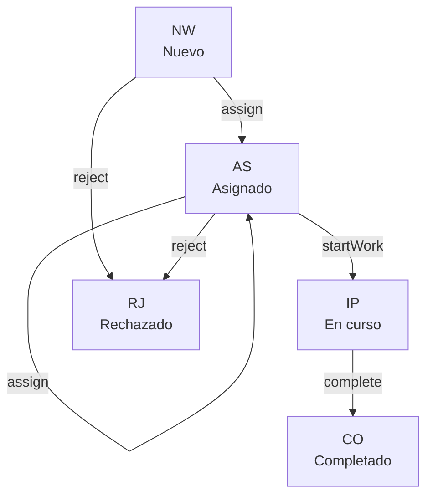

# Planificación de avisos: resumen del proyecto

| Dato | Valor |
|---|---|
| Nombre del proyecto | Avisos de mantenimiento |
| Código | MNT |
| Aplicación | `sapui5.maintenanceplanner`, SAP Fiori elements para OData V4 (List Report y Object Page) en TypeScript |
| Aplicación hermana | `sapui5.maintenance`, SAPUI5 freestyle, para el operario y el técnico |
| Servicio | El mismo servicio RAP OData V4 con borrador, descrito en `docs/servicio.md` |

La arquitectura y las decisiones técnicas están en `docs/arquitectura.md` y en `docs/adr/`.

## 1. Contexto

El proyecto "Avisos de mantenimiento" ya dispone de una aplicación freestyle para el operario de planta y el técnico: registrar averías con fotos, ejecutar la intervención y cerrarla. El planificador trabaja de otra forma: revisa muchos avisos a la vez, los filtra, los ordena por urgencia y decide si los asigna a un técnico o los rechaza.

Esa forma de trabajo corresponde a un patrón estándar de SAP Fiori: una lista con filtros y un detalle. Por eso el planificador tiene su propia aplicación, construida con SAP Fiori elements sobre el mismo servicio.

## 2. Objetivos

1. Bandeja de avisos para el planificador, con filtros, orden por fecha límite y estado destacado.
2. Detalle completo del aviso, con la información necesaria para decidir.
3. Asignar y rechazar avisos desde la bandeja y desde el detalle, con las reglas del servicio.
4. Mantener la aplicación con anotaciones y con el mínimo código posible.

## 3. Alcance

| Incluido | Historia |
|---|---|
| Aplicación generada, conectada al servicio, con borrador | HU-09 |
| Bandeja: columnas, filtros, orden y carga inicial | HU-10 |
| Detalle: cabecera, indicadores y secciones | HU-11 |
| Acciones de negocio sin código | HU-12 |
| Vista previa de las imágenes adjuntas | HU-13 |
| Página de indicadores | HU-14 |

## 4. Usuarios

| Rol | Necesidad en esta aplicación |
|---|---|
| Planificador | Revisar los avisos, asignarlos a un técnico o rechazarlos |
| Responsable de mantenimiento | Consultar los indicadores desde la bandeja (HU-14) |

El operario y el técnico usan la aplicación freestyle.

## 5. Ciclo de vida del aviso

Un aviso nace en estado Nuevo. El estado no se modifica como un campo: cambia solo mediante las acciones del servicio.

| Estado | Texto | Acciones disponibles | Modificable |
|---|---|---|---|
| `NW` | Nuevo | `assign`, `reject` | Sí |
| `AS` | Asignado | `assign` (reasignación), `startWork`, `reject` | Sí |
| `IP` | En curso | `complete` | Sí |
| `CO` | Completado | Ninguna | No |
| `RJ` | Rechazado | Ninguna | No |

## 6. Historias de usuario

| Historia | Descripción | Entrega |
|---|---|---|
| HU-09 | Aplicación del planificador generada con SAP Fiori tools | Sesión de trabajo conjunta |
| HU-10 | Bandeja de avisos: columnas, filtros, orden y criticidad | Sesión de trabajo conjunta |
| HU-11 | Detalle del aviso: cabecera, indicadores y secciones | Sesión de trabajo conjunta |
| HU-12 | Acciones de planificación sin código | Sesión de trabajo conjunta |
| HU-13 | Vista previa de adjuntos con el Flexible Programming Model | Sesión de trabajo conjunta, con agentes |
| HU-14 | Página de indicadores con el Flexible Programming Model | Tarea del sprint |

El texto completo de cada historia, con sus criterios de aceptación, está en `docs/especificacion/HU-NN.md`. Las historias se implementan en orden: cada una parte del resultado de la anterior.

## 7. Definición de terminado

Una historia está terminada cuando se cumplen todas estas condiciones:

1. Cumple todos los criterios de aceptación de la historia.
2. `npm run ts-typecheck`, `npm run lint` y `npx @ui5/linter` terminan sin errores, y la validación del `manifest.json` del servidor MCP de UI5 no da errores.
3. Está verificada en el navegador contra el servicio real.
4. Los textos visibles están en `i18n`, en inglés (`i18n.properties`) y en español (`i18n_es.properties`), también los de las anotaciones.
5. No hay código fuera de `webapp/ext/` y de `webapp/Component.ts`.
6. Tiene su commit en la rama de la historia, con mensaje convencional.

## 8. Fuera de alcance

- Autorizaciones por rol: la aplicación no distingue roles. La disponibilidad de cada operación depende del estado del aviso y la decide el servicio.
- Cambios en el servicio: las anotaciones de interfaz van en la aplicación (ver `docs/adr/ADR-006.md`).
- Launchpad y navegación entre las dos aplicaciones (clase 11) y despliegue (clase 12).
