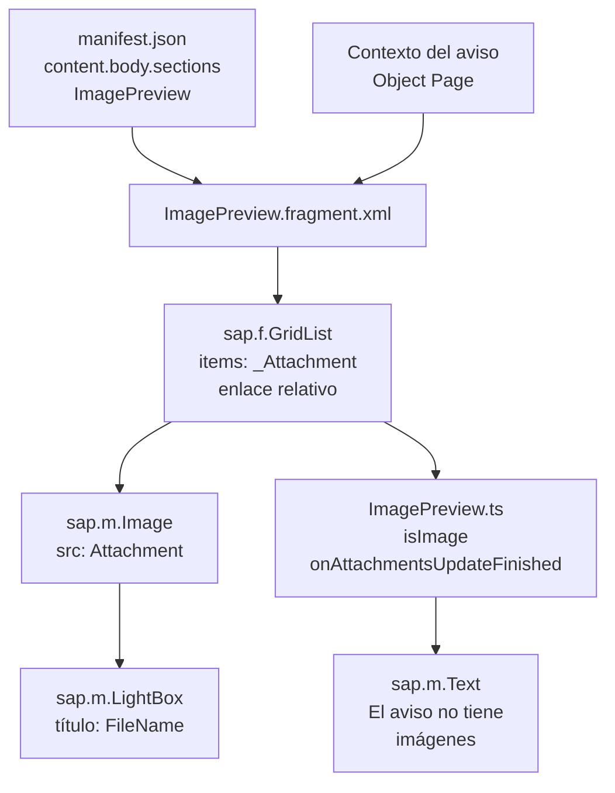

# HU-13. Plan: vista previa de adjuntos con el Flexible Programming Model

Historia: `docs/especificacion/HU-13.md`. Punto de partida: estado de `webapp/` tras HU-12 (commit `72f2b8c`).

## 1. Solución

Una sección propia del Flexible Programming Model, `ImagePreview`, declarada en `content.body.sections` de `RequestsObjectPage` y anclada después de la faceta `Attachments`. Su fragmento enlaza una cuadrícula `sap.f.GridList` de forma relativa a la navegación `_Attachment` del contexto del aviso, muestra cada imagen con `sap.m.Image` y abre la imagen a tamaño completo con `sap.m.LightBox` mediante la agregación `detailBox`, sin código. El manejador TypeScript se limita a dos funciones: el formateador que decide si un adjunto es una imagen y la alternancia entre la cuadrícula y el texto "sin imágenes".



## 2. Análisis por orden de preferencia

| Necesidad | Anotación | Ajuste del `manifest.json` | Flexible Programming Model |
|---|---|---|---|
| Sección nueva después de "Adjuntos" | Una faceta nueva en `UI.Facets` solo puede apuntar a un `UI.LineItem`, `UI.FieldGroup` o similar: genera una tabla o un formulario, no miniaturas | `content.body.sections` admite secciones propias con `template` y `position` | Sí: sección propia |
| Miniaturas solo de las imágenes | `UI.IsImage` se aplica a la propiedad `Attachment`, no a cada fila según `MimeType`: cambiaría la columna de la tabla "Adjuntos" de HU-11 para todos los adjuntos, sin filtrar por tipo y sin sección propia | No existe ajuste | Sí: `sap.f.GridList` con formateador de visibilidad |
| Imagen a tamaño completo con el nombre | No existe | No existe | `sap.m.Image#detailBox` con `sap.m.LightBox`, declarativo |
| Texto si no hay imágenes | No existe | No existe | Manejador de `updateFinished` |

Conclusión: coincide con la nota técnica de la historia y con ADR-007. No se modifica `webapp/annotations/annotation.xml`.

Control que muestra la imagen a tamaño completo, confirmado con `get_api_reference` (UI5 1.148): `sap.m.LightBox`, "The purpose of the control is to display an image in its original size as long as this is possible. On smaller screens images are scaled down to fit". Cada `sap.m.LightBoxItem` lleva `imageSrc`, `title`, `subtitle` y `alt`. `sap.m.Image#detailBox`: "A sap.m.LightBox instance that will be opened automatically when the user interacts with the Image control".

## 3. Criterios de aceptación

| Criterio | Mecanismo | Cómo se cumple |
|---|---|---|
| 1. Sección "Vista previa" inmediatamente después de "Adjuntos" | `manifest.json` | Sección propia `ImagePreview` con `position.placement` `After` y `position.anchor` `Attachments` (ID de la faceta, `docs/arquitectura.md` apartado 8). Título `{i18n>imagePreviewSectionTitle}` |
| 2. Miniaturas de los adjuntos cuyo tipo es una imagen | Fragmento | `sap.f.GridList` con `items="{_Attachment}"`; cada `sap.f.GridListItem` es visible solo si `isImage(MimeType)` (tipo que empieza por `image/`). La miniatura es `sap.m.Image` con `src="{Attachment}"`: en OData V4 el valor de una propiedad `Edm.Stream` enlazada a una propiedad de tipo `sap.ui.core.URI` es la URL de lectura del contenido (`sap.ui.model.odata.type.Stream`) |
| 3. Al pulsar, imagen a tamaño completo con el nombre del fichero | Fragmento, sin código | Agregación `detailBox` de la miniatura con un `sap.m.LightBox` y un `sap.m.LightBoxItem` con `imageSrc="{Attachment}"`, `title="{FileName}"` y `subtitle="{AttComment}"`. Se abre con clic, Intro o Espacio |
| 4. Texto si el aviso no tiene imágenes | Manejador | `onAttachmentsUpdateFinished` cuenta, tras cada actualización de la cuadrícula, los elementos cuyo `MimeType` es de imagen; si no hay ninguno oculta la cuadrícula y muestra el texto `imagePreviewNoImages`. Cubre los dos casos: aviso sin adjuntos y aviso con adjuntos que no son imágenes |
| 5. Usa el contexto de enlace del aviso; sin peticiones propias salvo la URL del contenido | Diseño del enlace | Ver apartado 3.1 |
| 6. Textos en inglés y en español | i18n | Dos claves nuevas en `i18n.properties` e `i18n_es.properties` (apartado 5) |

### 3.1 Criterio 5: decisiones de diseño

1. El enlace de la cuadrícula es relativo (`_Attachment`) y hereda el contexto que Fiori elements asigna a la página. No lleva `parameters`, `filters` ni `sorters`. La referencia de `ODataModel#bindList` lo establece: "The binding creates its own data service request if it is absolute or if it has any parameters or if it is relative and has a context created via createBindingContext or if it has sorters or filters". Por eso el filtro por tipo de imagen **no** se hace con un `Filter` en el enlace (generaría `$filter=startswith(MimeType,'image/')` en una petición propia), sino en el cliente, con la visibilidad de cada elemento.
2. El manejador solo lee `MimeType` con `Context#getProperty`, que según la API "Returns undefined if the data is not (yet) available; no request is initiated".
3. El código no crea modelos ni enlaces, no llama a `bindList`, `requestObject`, `requestProperty`, `refresh`, `fetch` ni `XMLHttpRequest`.
4. `densityAware="false"` en la miniatura evita las peticiones adicionales de variantes por densidad (`@2`); los elementos que no son imagen no se renderizan, así que no piden su contenido.
5. Las únicas peticiones que añade la sección fuera del `$batch` son los `GET .../Attachment` de cada imagen (miniatura y, si el navegador no la tiene en caché, la vista a tamaño completo).

Interpretación aplicada: los datos de `_Attachment` los resuelve el modelo OData V4 (`autoExpandSelect`) a partir del enlace relativo, dentro del `$batch` de la página. Esa lectura forma parte de "usar el contexto de enlace del aviso" y no es una petición de la sección. Si el responsable de producto exige que no aparezca ninguna lectura de `_Attachment` atribuible a la sección, hay que revisar la carga diferida de secciones (riesgo 2).

## 4. Ficheros

| Fichero | Acción |
|---|---|
| `webapp/manifest.json` | Se modifica: dependencias de librerías y sección propia de `RequestsObjectPage` |
| `webapp/ext/fragment/ImagePreview.fragment.xml` | Se crea |
| `webapp/ext/fragment/ImagePreview.ts` | Se crea |
| `webapp/i18n/i18n.properties` | Se modifica: dos claves al final |
| `webapp/i18n/i18n_es.properties` | Se modifica: dos claves al final |

No se modifican `webapp/annotations/annotation.xml`, `webapp/Component.ts`, `webapp/localService/` ni `docs/` fuera de `docs/plan/`.

### 4.1 `webapp/manifest.json`

**Bloque 1: `sap.ui5.dependencies.libs`.** El fragmento usa controles de `sap.f` (`GridList`, `GridListItem`) y de `sap.ui.layout` (`cssgrid.GridBoxLayout`). Se declaran como dependencias directas para que se precarguen.

Antes:

```json
      "libs": {
        "sap.m": {},
        "sap.ui.core": {},
        "sap.fe.templates": {}
      }
```

Después:

```json
      "libs": {
        "sap.m": {},
        "sap.ui.core": {},
        "sap.fe.templates": {},
        "sap.f": {},
        "sap.ui.layout": {}
      }
```

**Bloque 2: `sap.ui5.routing.targets.RequestsObjectPage`.** Se añade `content` a `options.settings`, después de `navigation`. El resto del destino no cambia.

Antes:

```json
        "RequestsObjectPage": {
          "type": "Component",
          "id": "RequestsObjectPage",
          "name": "sap.fe.templates.ObjectPage",
          "options": {
            "settings": {
              "editableHeaderContent": false,
              "contextPath": "/Requests",
              "navigation": {
                "_Task": {
                  "detail": {
                    "route": "TasksObjectPage"
                  }
                }
              }
            }
          }
        },
```

Después:

```json
        "RequestsObjectPage": {
          "type": "Component",
          "id": "RequestsObjectPage",
          "name": "sap.fe.templates.ObjectPage",
          "options": {
            "settings": {
              "editableHeaderContent": false,
              "contextPath": "/Requests",
              "navigation": {
                "_Task": {
                  "detail": {
                    "route": "TasksObjectPage"
                  }
                }
              },
              "content": {
                "body": {
                  "sections": {
                    "ImagePreview": {
                      "template": "sapui5.maintenanceplanner.ext.fragment.ImagePreview",
                      "title": "{i18n>imagePreviewSectionTitle}",
                      "position": {
                        "placement": "After",
                        "anchor": "Attachments"
                      }
                    }
                  }
                }
              }
            }
          }
        },
```

La clave `ImagePreview` va en inglés, como los ID de las facetas. En tiempo de ejecución la sección tiene el ID `fe::CustomSection::ImagePreview`.

### 4.2 `webapp/ext/fragment/ImagePreview.fragment.xml` (nuevo)

Contenido completo:

```xml
<core:FragmentDefinition
    xmlns="sap.m"
    xmlns:core="sap.ui.core"
    xmlns:f="sap.f"
    xmlns:grid="sap.ui.layout.cssgrid">
    <VBox core:require="{ handler: 'sapui5/maintenanceplanner/ext/fragment/ImagePreview' }">
        <f:GridList
            id="imagePreviewGrid"
            items="{_Attachment}"
            noDataText="{i18n>imagePreviewNoImages}"
            updateFinished="handler.onAttachmentsUpdateFinished">
            <f:customLayout>
                <grid:GridBoxLayout boxWidth="10rem"/>
            </f:customLayout>
            <f:GridListItem visible="{ path: 'MimeType', formatter: 'handler.isImage' }">
                <VBox class="sapUiSmallMargin">
                    <Image
                        src="{Attachment}"
                        alt="{FileName}"
                        decorative="false"
                        densityAware="false"
                        lazyLoading="true"
                        width="100%">
                        <detailBox>
                            <LightBox>
                                <LightBoxItem
                                    imageSrc="{Attachment}"
                                    title="{FileName}"
                                    subtitle="{AttComment}"
                                    alt="{FileName}"/>
                            </LightBox>
                        </detailBox>
                    </Image>
                    <Text text="{FileName}" maxLines="2" class="sapUiTinyMarginTop"/>
                </VBox>
            </f:GridListItem>
        </f:GridList>
        <Text id="imagePreviewNoImages" text="{i18n>imagePreviewNoImages}" visible="false"/>
    </VBox>
</core:FragmentDefinition>
```

Notas para el desarrollador:

- Un único control raíz (`VBox`), como exige el fragmento de una sección propia.
- `items="{_Attachment}"` se escribe sin `parameters`, `filters` ni `sorters` (apartado 3.1). No se añade `growing`.
- Sin ID dentro de la plantilla `GridListItem`: se clona por cada adjunto.
- Solo `width="100%"` en la miniatura, sin `height`, para conservar la proporción de la imagen sin CSS propio.
- `noDataText` cubre el instante en que la cuadrícula está vacía antes de que el manejador la oculte; usa el mismo texto para que no se vea "No data".
- Los textos del fragmento usan el modelo `i18n` del componente.

### 4.3 `webapp/ext/fragment/ImagePreview.ts` (nuevo)

Contenido completo:

```ts
import type ExtensionAPI from "sap/fe/templates/ObjectPage/ExtensionAPI";
import type { ListBase$UpdateFinishedEvent } from "sap/m/ListBase";
import Control from "sap/ui/core/Control";

/** Prefix of the MIME types that the preview shows as images. */
const IMAGE_MIME_TYPE_PREFIX = "image/";

/** Local ID, in the fragment, of the text shown when the request has no image attachments. */
const NO_IMAGES_TEXT_ID = "imagePreviewNoImages";

/**
 * Formatter for the visibility of a thumbnail.
 *
 * @param mimeType Value of the MimeType property of the attachment
 * @returns true if the attachment is an image
 */
export function isImage(mimeType: unknown): boolean {
	return typeof mimeType === "string" && mimeType.toLowerCase().startsWith(IMAGE_MIME_TYPE_PREFIX);
}

/**
 * Shows the thumbnail grid if at least one attachment is an image, and the "no images" text otherwise.
 * It only reads data already held by the binding contexts: Context#getProperty never sends a request.
 *
 * @param this Extension API of the object page
 * @param event updateFinished event of the thumbnail grid
 */
export function onAttachmentsUpdateFinished(this: ExtensionAPI, event: ListBase$UpdateFinishedEvent): void {
	const grid = event.getSource();
	const hasImages = grid.getItems().some((item) => isImage(item.getBindingContext()?.getProperty("MimeType")));
	grid.setVisible(hasImages);
	const noImagesText = this.byId(NO_IMAGES_TEXT_ID);
	if (noImagesText instanceof Control) {
		noImagesText.setVisible(!hasImages);
	}
}
```

Notas para el desarrollador:

- Tipos comprobados en `@sapui5/types` 1.148: `ListBase$UpdateFinishedEvent` es `Event<ListBase$UpdateFinishedEventParameters, ListBase>` y `ExtensionAPI#byId(id)` devuelve `UI5Element | undefined` ("ID of the control without view and section prefix").
- Sin `any`: el valor de `getProperty` se pasa a un parámetro `unknown`.
- `isImage` es a la vez el formateador del fragmento y la regla del manejador: una sola definición de "imagen".
- La agregación `detailBox` resuelve el criterio 3 sin código: no se añade manejador de `press`.

### 4.4 `webapp/i18n/i18n.properties`

Se añade al final del fichero, después de `actionReject=Reject`, con una línea en blanco antes:

```properties
#Texts for extensions

#XTIT: Title of the custom section with the preview of the image attachments
imagePreviewSectionTitle=Preview

#XMSG: Text shown in the preview section when the request has no image attachments
imagePreviewNoImages=This request has no images.
```

### 4.5 `webapp/i18n/i18n_es.properties`

Se añade al final del fichero, después de `actionReject=Rechazar`, con una línea en blanco antes. Los comentarios se mantienen en inglés, como en el resto del fichero:

```properties
#Texts for extensions

#XTIT: Title of the custom section with the preview of the image attachments
imagePreviewSectionTitle=Vista previa

#XMSG: Text shown in the preview section when the request has no image attachments
imagePreviewNoImages=El aviso no tiene imágenes.
```

## 5. Claves de i18n nuevas

| Clave | Tipo | Inglés | Español | Uso |
|---|---|---|---|---|
| `imagePreviewSectionTitle` | `#XTIT` | Preview | Vista previa | Título de la sección en el `manifest.json` |
| `imagePreviewNoImages` | `#XMSG` | This request has no images. | El aviso no tiene imágenes. | `noDataText` de la cuadrícula y texto de la sección sin imágenes |

El nombre del fichero, el comentario y el texto alternativo de las imágenes son datos del servicio (`FileName`, `AttComment`) y no llevan clave. Los textos internos de `sap.m.LightBox` (botón de cierre, error de carga) los aporta la librería.

## 6. Riesgos

| Nº | Riesgo | Probabilidad | Medida |
|---|---|---|---|
| 1 | `this` del manejador no es el `ExtensionAPI` de la página y `this.byId` falla | Baja: es el patrón de los manejadores de fragmentos del FPM y la firma que genera SAP Fiori tools | Prueba del criterio 4 sin errores en consola. Si falla, el texto se localiza como hermano de la cuadrícula: `grid.getParent()` comprobado con `instanceof VBox` y sus `getItems()` |
| 2 | Con `enableLazyLoading`, la sección se crea cuando se hace visible y el modelo puede leer `_Attachment` en una subpetición del `$batch` en lugar de en el `$expand` de la lectura del aviso | Media | Es la resolución automática del enlace relativo, no una petición de la sección (apartado 3.1). No se cambia `enableLazyLoading`: afecta a toda la aplicación |
| 3 | La URL de cada imagen la calcula el modelo a partir de la ruta (la respuesta no trae `@odata.mediaReadLink`) | Baja: la descarga desde la tabla "Adjuntos" de HU-11 usa el mismo mecanismo | Comprobar `200` y `Content-Type: image/svg+xml` en el `GET .../Attachment` de cada miniatura |
| 4 | El ancla `Attachments` no se resuelve. Como "Adjuntos" es la última sección, el orden visual sería correcto aunque el ancla fallara | Baja | Revisar la consola: ningún aviso de Fiori elements sobre el ancla o la posición de la sección |
| 5 | En edición, si se sube o se borra un adjunto en "Adjuntos", la vista previa no se actualiza hasta guardar o descartar | Alta en edición | Limitación aceptada: subir y borrar desde la vista previa está fuera de alcance. Al activar el borrador la página cambia de contexto y la sección se actualiza |
| 6 | Un adjunto subido sin `Content-Disposition` tiene `FileName` vacío: la vista a tamaño completo queda sin título y la imagen sin texto alternativo | Baja: los datos iniciales tienen nombre | Sin medida en esta historia; se documenta |

## 7. Comprobaciones

### 7.1 Desarrollador y revisor

1. `npm run ts-typecheck` sin errores.
2. `npm run lint` sin errores.
3. `npx @ui5/linter` sin errores (incluye la resolución de `handler.onAttachmentsUpdateFinished` y `handler.isImage` por `core:require`).
4. `run_manifest_validation` del servidor MCP de UI5 sobre `webapp/manifest.json` sin errores.
5. `git diff`: solo cambian los cinco ficheros del apartado 4; las facetas mantienen sus ID; no hay cambios en `annotation.xml`, `localService/` ni `docs/` fuera de `docs/plan/`.
6. Búsqueda en `webapp/ext/`: ninguna aparición de `any`, `fetch`, `XMLHttpRequest`, `bindList`, `requestObject` ni `requestProperty`.

### 7.2 Probador (servicio real, `sap-language=ES` y después `EN`)

| Criterio | Comprobación | Resultado esperado |
|---|---|---|
| 1 | Abrir el aviso `10000001` | Barra de anclaje: "Datos generales", "Ejecución", "Operaciones", "Repuestos", "Adjuntos", "Vista previa", en ese orden. En inglés, "Preview" |
| 2 | Avisos `10000001`, `10000007` y `10000013`, sección "Vista previa" | Una miniatura por cada adjunto SVG, con el nombre del fichero debajo; el número coincide con las filas de "Adjuntos" |
| 3 | Pulsar una miniatura con el ratón; repetir con el teclado (foco en la miniatura e Intro) | Se abre la vista a tamaño completo con el nombre del fichero como título; se cierra con el botón de cierre o Escape |
| 4 | Un aviso sin adjuntos (por ejemplo `10000002`; confirmar que su sección "Adjuntos" está vacía) | La sección muestra "El aviso no tiene imágenes." y no muestra la cuadrícula. En inglés, "This request has no images." |
| 4, opcional | En un aviso propio (`[DEMO]` o iniciales), subir desde "Adjuntos" un fichero que no sea imagen y guardar | La sección muestra el texto de "sin imágenes" y no una cuadrícula vacía |
| 4 | Navegar de `10000002` a `10000001` sin recargar | La cuadrícula vuelve a aparecer con la miniatura |
| 5 | Pestaña Red al abrir `10000001` y al llegar a la sección | Ninguna petición con `$filter`, `$orderby` ni `$count` sobre `_Attachment` atribuible a la sección (la tabla "Adjuntos" de HU-11 tiene la suya); fuera del `$batch`, solo los `GET .../Attachment` de cada imagen, con respuesta `200`; ninguna petición con `@2` en la URL |
| 6 | Repetir 1 y 4 con `sap-language=EN` | Textos en inglés |
| Todos | Consola del navegador | Sin errores propios; los 404 de `/sap/bc/lrep` y de `changes-bundle.json` no cuentan |

### 7.3 Cierre de la historia

Commit en la rama de la historia con mensaje convencional, por ejemplo `feat(HU-13): vista previa de imágenes adjuntas en el detalle del aviso`.

## 8. Fuera de alcance

Subir o borrar adjuntos desde la vista previa (historia). Tampoco se incluyen navegación entre imágenes dentro de la vista a tamaño completo ni miniaturas de documentos que no son imágenes.
